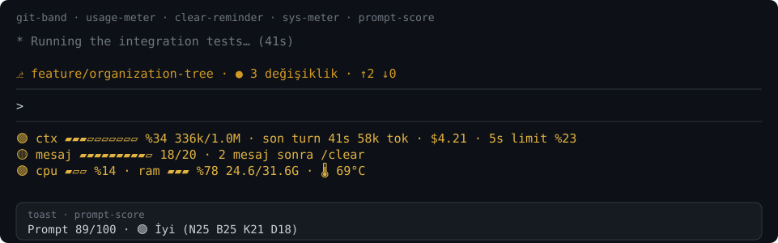
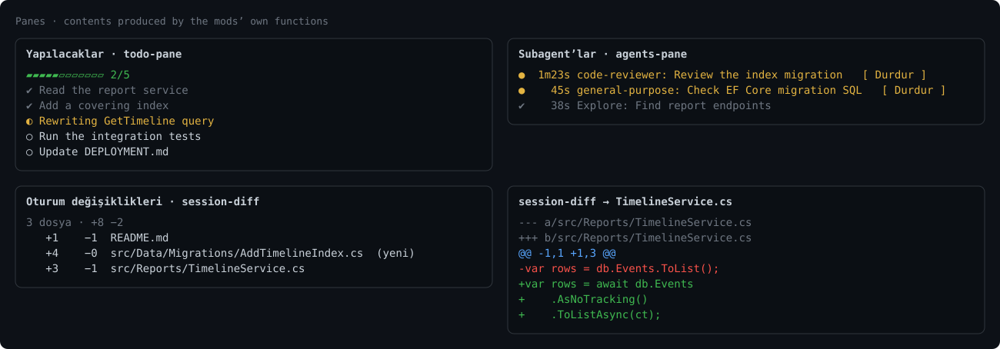
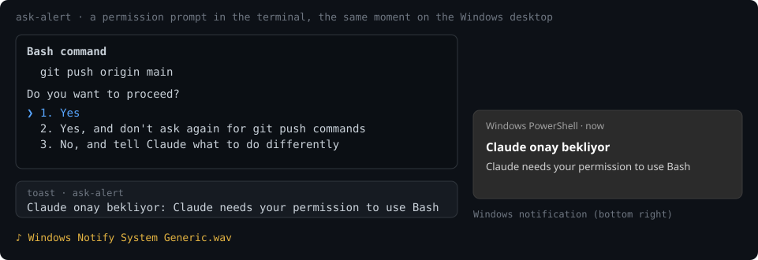

# claude-mods

**English** · [Türkçe](#türkçe)

Small, focused mods for [Claude Code](https://claude.com/claude-code), built on its function-hook plugin API. Each folder is one plugin; the repo root is a plugin marketplace, so you install only the mods you want.



## What's new

- **ask-alert**, new: a Windows notification and a sound when Claude waits for you (a permission prompt, `AskUserQuestion`, an idle prompt).
- **sys-meter**, a new status line: CPU, RAM and temperature every 5 s.
- **clawd-spinner, rewritten.** 17 scenes, one picked at random for every command and never the same twice in a row (10 new: rain, fishing, music, laptop, ball, rocket, plant, bug, blocks, sleep). The default band is now 16×1 cells, drawn with Unicode 16 block octants (2×4 pixels per cell), a quarter of the old size. `size: large` in `/config` brings back the 32×2 half-block band ([preview](docs/clawd-large.svg)). The large band animates with `$.ui.blit`, so the rest of the band is not redrawn every frame.
- **clear-reminder** is a status line now, styled like usage-meter.
- **usage-meter** writes percents as `%34`; `34% 336k` came out garbled in the status line.
- **git-band** runs `git status` with `core.fsmonitor` off, so a cloned repo's config cannot start a program every 15 s.
- New mods: `todo-pane`, `agents-pane`, `git-band`, `time-tracker`, `session-journal`.

## What's inside

### See what Claude is doing

| Mod | What it does |
| --- | --- |
| [`usage-meter`](usage-meter) | Status line: context fill bar with tokens/window, a live turn timer, the last turn's tokens, session cost and 5-hour rate-limit usage. |
| [`clear-reminder`](clear-reminder) | Status line counting prompts since the last `/clear` (`🟢 mesaj ▰▰▱ 7/20`); turns yellow at 17 and red at 20, with a toast. |
| [`sys-meter`](sys-meter) | Status line with CPU load, RAM usage and temperature (`🟢 cpu ▰▱▱ %14 · ram ▰▰▰ %78 24.6/31.6G · 🌡 69°C`), refreshed every 5 s. Windows only; the temperature is the ACPI thermal zone, readable without admin rights, not the CPU package sensor. |
| [`git-band`](git-band) | One line above the prompt: branch, changed-file count, ahead/behind. Refreshes every 15 s and after each turn. |
| [`todo-pane`](todo-pane) | Live pane of Claude's todo list (TodoWrite or TaskCreate/TaskUpdate) with a progress bar. Opens by itself; `/todos` reopens it. |
| [`agents-pane`](agents-pane) | Live pane of subagents with status, elapsed time and a **Stop** button for each running one. `/subagents` reopens it. |
| [`session-diff`](session-diff) | `/session-diff` lists every file changed this session with `+/−` counts; press a file to read its diff (`b` back, `k`/`j` page). |





### Habits and records

| Mod | What it does |
| --- | --- |
| [`prompt-score`](prompt-score) | Toasts a quality score for every prompt you type (clarity, context, specificity, verifiability) with one hint for the weakest part. Local rules, no API calls. Hints are in Turkish. |
| [`time-tracker`](time-tracker) | Adds up how long Claude works per project per day; `/zaman` shows the last 7 days. |
| [`session-journal`](session-journal) | Appends one line per turn to `~/.claude/journal/<date>.md`; `/gunluk` adds a Haiku-written summary of the session. |

### Fun

| Mod | What it does |
| --- | --- |
| [`clawd-spinner`](clawd-spinner) | A tiny 16×1 band under the spinner (block octants; set `size` to `large` in `/config` for a 32×2 half-block band if your font lacks octants) where pixel-art Clawd plays one of 17 scenes, picked at random for every command (UFO, cooking, fishing, rain, music, laptop, rocket, growing plant, falling blocks, sleeping…). Time-of-day backdrop: morning coffee, a night sky, Friday-evening confetti. |

### Notifications

| Mod | What it does |
| --- | --- |
| [`ask-alert`](ask-alert) | When Claude waits for you (a permission prompt from an `ask` rule, an `AskUserQuestion`, an idle prompt, an MCP input request) it raises a Windows notification, a toast in the terminal and plays `Windows Notify System Generic.wav`. `mode` in `/plugin configure`: `both` (default), `toast` or `sound`. Windows only. |
| [`done-sound`](done-sound) | Plays a sound when Claude finishes answering (Windows, through PowerShell's MediaPlayer). |



## Install

At a Claude Code prompt:

```
/plugin install usage-meter --marketplace kad1r/claude-mods
```

Answer `y` to add the marketplace, then pick a scope. Repeat with any mod name from the tables above. `/reload-plugins` picks up updates.

**done-sound:** the sound file is not in the repo. Put any mp3 at `done-sound/sounds/done.mp3` inside the installed plugin folder.

## Notes

- Function hooks are an early-access API of Claude Code and may change between releases. These mods were written and tested on Claude Code 2.1.296; `ask-alert` on 2.1.300.
- `session-journal` writes the first line of your prompts to disk in plain text. Keep that in mind if you paste secrets into prompts.
- `/gunluk` makes one Haiku request each time you run it.
- `ask-alert` does not fire in `bypassPermissions` mode for permission prompts, since none are shown. Where an organization manages Claude Code, its `Notification` hook runs only if the organization lists the plugin; the `AskUserQuestion` alert still works.
- The images above are drawn from the mods' own output (Clawd's frames from `scene.ts`, the status-line and pane text from each mod's functions), not cropped from a live session. The Windows notification in `ask-alert.svg` is drawn to look like the real one.

## Develop

Each mod is three files: `.claude-plugin/plugin.json`, `hooks/hooks.json` and a hooks module in `hooks/`. Mods that keep values in `$.state` also have `types/index.d.ts`.

```
claude plugin validate ./<mod>
claude plugin test ./<mod>
```

To run from a local clone, add it as a marketplace (`claude plugin marketplace add <path>`), install from it, and run `/reload-plugins` after edits; the plugin is read straight from the folder.

---

<a id="türkçe"></a>

# claude-mods (Türkçe)

[English](#claude-mods) · **Türkçe**

[Claude Code](https://claude.com/claude-code) için küçük, tek işe odaklı mod'lar. Hepsi Claude Code'un function-hook plugin API'si ile yazıldı. Her klasör bir plugin; repo kökü bir plugin marketplace'i, yani sadece istediğin mod'ları kurarsın.


## Yenilikler

- **ask-alert**, yeni: Claude seni beklediğinde (izin isteği, `AskUserQuestion`, boşta kalan prompt) Windows bildirimi ve ses.
- **sys-meter**, yeni durum satırı: 5 saniyede bir CPU, RAM ve sıcaklık.
- **clawd-spinner baştan yazıldı.** 17 sahne var; her komutta biri rastgele seçiliyor ve aynısı art arda gelmiyor (10 yeni: yağmur, balık tutma, müzik, laptop, top, roket, bitki, böcek, bloklar, uyku). Varsayılan bant artık 16×1 hücre, Unicode 16 blok octant karakterleriyle çiziliyor (hücre başına 2×4 piksel), eskisinin dörtte biri. `/config` içinde `size: large` seçilirse 32×2'lik yarım-blok bant geri gelir ([önizleme](docs/clawd-large.svg)). Büyük bant `$.ui.blit` ile oynuyor, yani her karede bandın geri kalanı yeniden çizilmiyor.
- **clear-reminder** artık usage-meter gibi bir durum satırı.
- **usage-meter** yüzdeyi `%34` biçiminde yazıyor; `34% 336k` durum satırında bozuk görünüyordu.
- **git-band** `git status`'u `core.fsmonitor` kapalı çalıştırıyor; klonlanan bir reponun ayarı 15 saniyede bir program başlatamaz.
- Yeni mod'lar: `todo-pane`, `agents-pane`, `git-band`, `time-tracker`, `session-journal`.

## Neler var

### Claude ne yapıyor, gör

| Mod | Ne yapar |
| --- | --- |
| [`usage-meter`](usage-meter) | Durum satırı: context doluluk çubuğu ve token/pencere, canlı turn sayacı, son turn'ün token'ı, oturum maliyeti, 5 saatlik limit kullanımı. |
| [`clear-reminder`](clear-reminder) | Son `/clear`'dan beri yazdığın mesajları sayan durum satırı (`🟢 mesaj ▰▰▱ 7/20`); 17'de sarı, 20'de kırmızı olur ve toast gösterir. |
| [`sys-meter`](sys-meter) | CPU yükü, RAM kullanımı ve sıcaklığı gösteren durum satırı (`🟢 cpu ▰▱▱ %14 · ram ▰▰▰ %78 24.6/31.6G · 🌡 69°C`), 5 saniyede bir yenilenir. Sadece Windows; sıcaklık admin yetkisi gerektirmeyen ACPI thermal zone değeridir, CPU paket sensörü değil. |
| [`git-band`](git-band) | Prompt'un üstünde tek satır: branch, değişen dosya sayısı, ahead/behind. 15 saniyede bir ve her turn sonunda yenilenir. |
| [`todo-pane`](todo-pane) | Claude'un yapılacaklar listesini (TodoWrite veya TaskCreate/TaskUpdate) ilerleme çubuğuyla gösteren canlı panel. Kendiliğinden açılır; `/todos` tekrar açar. |
| [`agents-pane`](agents-pane) | Subagent'ları durum ve süreyle gösteren canlı panel; çalışan her birinin yanında **Durdur** butonu. `/subagents` tekrar açar. |
| [`session-diff`](session-diff) | `/session-diff` bu oturumda değişen dosyaları `+/−` sayılarıyla listeler; bir dosyaya basınca diff'ini gösterir (`b` geri, `k`/`j` sayfa). |


### Alışkanlık ve kayıt

| Mod | Ne yapar |
| --- | --- |
| [`prompt-score`](prompt-score) | Yazdığın her prompt'a kalite puanı verir (netlik, bağlam, kapsam, doğrulanabilirlik) ve en zayıf kısım için tek bir ipucu gösterir. Yerel kurallar, API çağrısı yok. |
| [`time-tracker`](time-tracker) | Claude'un proje bazında günlük çalıştığı süreyi toplar; `/zaman` son 7 günü gösterir. |
| [`session-journal`](session-journal) | Her turn için `~/.claude/journal/<tarih>.md` dosyasına bir satır ekler; `/gunluk` oturumun Haiku ile yazılmış özetini ekler. |

### Eğlence

| Mod | Ne yapar |
| --- | --- |
| [`clawd-spinner`](clawd-spinner) | Spinner'ın altında 16×1'lik minik bir bant (blok octant karakterleri; fontun bunları çizmiyorsa `/config`'ten `size` ayarını `large` yap, 32×2 yarım-blok bant gelir): piksel Clawd her komutta rastgele seçilen 17 sahneden birini oynar (UFO, yemek, balık tutma, yağmur, müzik, laptop, roket, büyüyen çiçek, düşen bloklar, uyku…). Arka plan saate göre değişir: sabah kahve, gece gökyüzü, cuma akşamı konfeti. |

### Bildirimler

| Mod | Ne yapar |
| --- | --- |
| [`ask-alert`](ask-alert) | Claude seni beklediğinde (`ask` kuralından gelen izin isteği, `AskUserQuestion`, boşta kalan prompt, MCP'nin bilgi isteği) Windows bildirimi ve terminal içi toast gösterir, `Windows Notify System Generic.wav` çalar. `/plugin configure` içinde `mode`: `both` (varsayılan), `toast` veya `sound`. Sadece Windows. |
| [`done-sound`](done-sound) | Claude cevabı bitirince ses çalar (Windows, PowerShell MediaPlayer ile). |


## Kurulum

Claude Code prompt'unda:

```
/plugin install usage-meter --marketplace kad1r/claude-mods
```

Marketplace'i eklemek için `y` de, sonra scope seç. Tablolardaki diğer mod adlarıyla tekrarla. Güncellemeler için `/reload-plugins`.

**done-sound:** Ses dosyası repoda yok. Kurulan plugin klasöründe `done-sound/sounds/done.mp3` yoluna istediğin bir mp3 koy.

## Notlar

- Function hook'lar Claude Code'un erken erişim API'si; sürümler arasında değişebilir. Bu mod'lar Claude Code 2.1.296 üzerinde yazılıp test edildi; `ask-alert` 2.1.300 üzerinde.
- `session-journal`, prompt'larının ilk satırını diske düz metin olarak yazar. Prompt'a secret yapıştırıyorsan bunu göz önünde tut.
- `/gunluk` her çalıştığında bir Haiku isteği yapar.
- `ask-alert`, `bypassPermissions` modunda izin uyarısı vermez, çünkü izin ekranı çıkmaz. Claude Code'u organizasyon yönetiyorsa `Notification` hook'u ancak organizasyon plugin'i listelerse çalışır; `AskUserQuestion` uyarısı yine çalışır.
- Yukarıdaki görseller mod'ların kendi çıktısından çizildi (Clawd kareleri `scene.ts`'den, durum satırı ve panel metinleri mod fonksiyonlarından); canlı oturumdan kırpılmadı. `ask-alert.svg` içindeki Windows bildirimi gerçeğine benzetilerek çizildi.

## Geliştirme

Her mod üç dosyadan oluşur: `.claude-plugin/plugin.json`, `hooks/hooks.json` ve `hooks/` altında bir hooks modülü. `$.state` kullananlarda ayrıca `types/index.d.ts` vardır.

```
claude plugin validate ./<mod>
claude plugin test ./<mod>
```

Yerel bir klondan çalıştırmak için klonu marketplace olarak ekle (`claude plugin marketplace add <yol>`), oradan kur ve değişikliklerden sonra `/reload-plugins` çalıştır; plugin doğrudan klasörden okunur.
